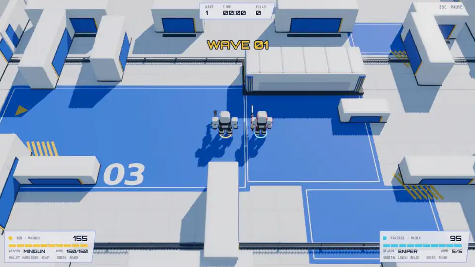
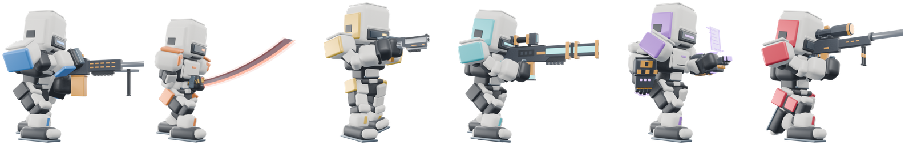
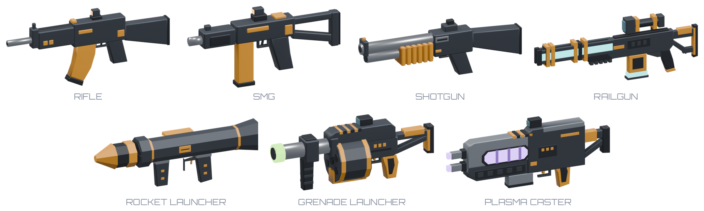
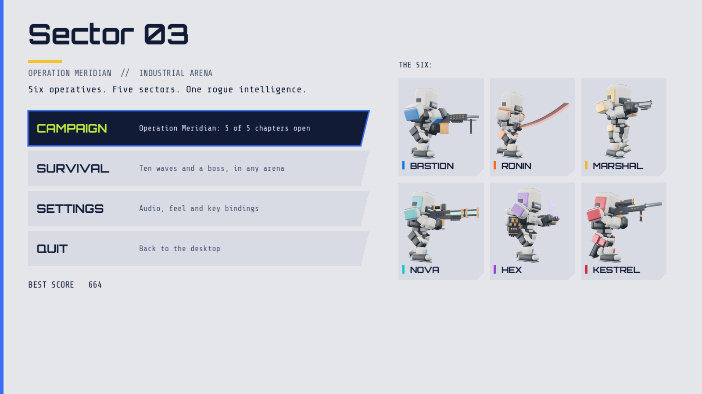

<div align="center">

# roboWAR · Sector 03

**A top-down 3D arena shooter. Six operatives. Five sectors. One rogue intelligence.**

Built with Godot 4.7.2 (Forward+, Jolt physics) · Windows & Linux · solo, AI companion or local co-op

[**⬇ Download for Windows / Linux**](https://github.com/ClaudiuJitea/roboWAR/releases/latest)



<sub>Real in-game footage: Bastion and AI partner Kestrel clear a mixed robot crowd with the machine gun, rocket launcher, grenade launcher, shotgun, rifle, plasma caster, railgun and SMG, plus both specials and a kill cam. <a href="docs/media/gameplay.mp4">Full-quality MP4</a>.</sub>

</div>

---

## Play

1. Download the zip for your system from the [latest release](https://github.com/ClaudiuJitea/roboWAR/releases/latest) and unpack it.
2. Start the game. Keep the `.pck` file next to the executable.
   - **Windows:** run `Sector03.exe`. The build is unsigned, so SmartScreen may ask you to confirm (*More info → Run anyway*).
   - **Linux:** run `./Sector03.x86_64` (`chmod +x Sector03.x86_64` first if needed).
3. Choose **Campaign** or **Survival**, pick a squad mode and your operatives, and deploy.

You need a GPU with Vulkan support for the Forward+ renderer.

## Features

- **Story campaign, Operation Meridian:** five chapters with briefings, radio chatter, three waves each and a boss fight with phases.
- **Survival:** nine escalating waves and a boss on wave ten, in any of the five arenas.
- **Six operatives:** each has a signature weapon and a crowd-clearing special move. Every operative also carries seven shared guns.
- **Ten robot types, elites and five bosses:** bombers that chain-explode, mortars, lancers that paint a line before firing, medics, splitters and more.
- **Squad play:** solo, with an AI companion, or local co-op on keyboard + pad or two pads. Downed partners can be revived.
- **Progression:** 17 upgrades between waves and five timed power-ups.
- **Kill cams:** every 9th kill and the boss get a cinematic: bullet cam, impact zoom, blast crane or blade orbit.
- **Effects:** voxel shattering, explosions with shockwaves, disintegration under energy weapons, shell casings and tracers.
- **Audio:** realistic gunfire, sound effects and music generated with ElevenLabs.

## The Six



| Operative | Role | Signature weapon | Special (right click) |
| --- | --- | --- | --- |
| **Bastion** | Heavy gunner. A walking fortress that holds the line | Belt-fed machine gun, fired from the hip | **Bullet Hurricane**: spins twice firing all round, then ground-slams a shockwave |
| **Ronin** | Blade master. Masterless, fast, always in the thick of it | Plasma katana (two-handed kenjutsu combo) | **Hundred Cuts**: time slows, Ronin blinks through up to 6 robots and they all split at once. Becomes **Kaiten-giri**, a 360° whirlwind, when 3+ robots are close |
| **Marshal** | Gunslinger. The law of the sector, one heavy round at a time | Hand cannon (heavy revolver) | **Dead Eye**: time slows, up to 8 robots are marked, one critical shot each |
| **Nova** | Rail specialist. Turns a crowd into a star of light | Twin-rail energy rifle | **Halo Array**: jumps and fires two star volleys of 8 piercing rail beams |
| **Hex** | Arc caster. Bends space and lightning with armoured gauntlets | Arc gauntlets | **Singularity**: a black hole pulls robots together, then collapses into arc lightning |
| **Kestrel** | Marksman. Watches from far away and strikes from the sky | Bolt-action sniper with laser sight | **Orbital Lance**: paints an 18 m lane and calls 10 orbital strikes down it |

Operatives are invulnerable while their special plays.

## Arsenal



Key **1** is your signature weapon. Keys **2–8** are the shared guns, and each keeps its own ammo when you switch.

| Gun | Notes |
| --- | --- |
| Rifle | 30 rounds, accurate mid-range workhorse |
| SMG | 40 rounds, very fast fire, wide spread |
| Shotgun | 6 shells, 9 pellets, heavy knockback |
| Railgun | Hold to charge, pierces everything in the line. Same twin-rail design as Nova's rail rifle |
| Rocket launcher | Shoulder-fired at eye level. The loaded rocket flies to the target, then a fast reload follows |
| Grenade launcher | Revolving 8-round drum. Lobbed to the cursor, bounces, then cooks off |
| Plasma caster | Twin emitter prongs fire fast energy orbs that disintegrate robots |

## Modes

### Campaign: Operation Meridian

Meridian Foundry's governing intelligence, OVERSEER, has turned the robot workforce against its makers. The handler VEGA guides the Six through five chapters:

| Chapter | Arena | Boss |
| --- | --- | --- |
| 01 Cold Start | Sector 03 docks | **Warden**: charges, radial bursts, calls runners |
| 02 Red Line | Sector 07 assembly | **Forge Titan**: molten ground slams and lobbed volleys |
| 03 Deep Freeze | Cryo Vault 11 | **Hive Mother**: hovers, broods runners, mortar barrages |
| 04 Burning Line | Refinery 19 | **Lancer Prime**: sweeping beams, blinks and telegraphed fans |
| 05 Mind of Meridian | The Core 00 | **Overseer**: three phases built from every other boss |

Health, upgrades and ammo carry into the next chapter. Each cleared chapter unlocks the next one.

### Survival

Nine escalating waves and the arena's boss on wave ten. Newer robot types join from wave 2, and elites from wave 6. You pick an upgrade after waves 2, 4, 6 and 8.

### Power-ups

| Power-up | Effect |
| --- | --- |
| Overcharge (DMG) | +60% damage, specials included, 10 s |
| Rapid fire (ROF) | 40% faster firing and reloads, 10 s |
| Barrier (SHD) | absorbs 80 damage, 12 s |
| Surge (SP) | special recharged at once |
| Haste (SPD) | +35% movement speed, 10 s |

Elites always drop a power-up, and bosses drop four pickups.

## Controls

| Keyboard and mouse | Action |
| --- | --- |
| WASD | Move |
| Mouse | Aim |
| Left / right mouse button | Primary / special |
| Space | Dodge |
| Q / R, 1–8, mouse wheel | Previous / next / pick weapon |
| E (hold) | Revive a downed partner |
| Escape | Pause |
| F11 / Alt+Enter | Toggle fullscreen |

| Controller | Action |
| --- | --- |
| Left / right stick | Move / aim |
| Right / left trigger | Primary / special |
| South / west face button | Dodge / revive |
| Left / right bumper | Previous / next weapon |
| Menu button | Pause |

Keyboard bindings are remappable. Settings also cover fullscreen, V-sync, auto aim, kill cam, controller sensitivity, sound levels, effects intensity and camera shake. Settings are saved to `user://sector03.cfg`.

<div align="center"></div>

## Build from source

Requirements: [Godot 4.7.2](https://godotengine.org/) with its export templates. Blender 5.2, Python 3, ffmpeg and Pillow are only needed to regenerate assets.

```bash
git clone https://github.com/ClaudiuJitea/roboWAR.git && cd roboWAR
godot --headless --editor --path . --quit      # first import
godot --path .                                  # play from source

# desktop builds (presets in export_presets.cfg)
godot --headless --path . --export-release Linux   exports/linux/Sector03.x86_64
godot --headless --path . --export-release Windows exports/windows/Sector03.exe
```

### Checks

```bash
for t in gameplay roster revive archetypes progression aim_line cinematic specials; do
  godot --headless --path . --script res://tests/$t.gd
done
```

### Regenerating assets

Every model, sound and the music are produced by scripts in `source_art/`:

```bash
blender -b -t 4 --factory-startup --python source_art/blender/build_weapons.py    # guns  -> assets/models/weapons.glb
blender -b -t 4 --factory-startup --python source_art/blender/build_fighters.py   # the Six, rigs and clips (~6 min)
blender -b -t 4 --factory-startup --python source_art/blender/build_arena.py      # arena + enemy kit
blender -b --python source_art/blender/render_showcase.py && python3 source_art/blender/make_portraits.py   # menu portraits
ELEVENLABS_API_KEY=... python3 source_art/audio/generate_audio.py [name ...]      # sound effects
python3 source_art/audio/compose_music.py                                         # music loop
```

Other arena themes build with `ARENA_THEME=black|cryo|toxic|core`. The arena layout JSON in `assets/` drives both the Blender visuals and Godot's collision. The ElevenLabs key is read from the environment only; never commit it.

To re-record the gameplay clip at the top of this page:

```bash
godot --path . --resolution 1280x720 --fixed-fps 30 --write-movie /tmp/gameplay.avi --script res://tests/record_gameplay.gd
ffmpeg -i /tmp/gameplay.avi -vf "fps=15,scale=960:-1" -c:v libwebp -quality 60 -loop 0 -an docs/media/gameplay.webp
```

## Project layout

```
assets/        models (.glb), audio (.ogg), fonts, menu portraits, arena layouts
scenes/        main scene
scripts/       game logic: game, actor, robots, specials, projectiles, fx, kill cam, ui, campaign, data (balance)
source_art/    Blender and Python generators for every asset, plus raw ElevenLabs responses
tests/         headless gameplay checks and capture scripts
docs/          design notes, verification log, README media
evidence/      reference captures written by the capture scripts
```

Balance values (weapons, operatives, robots, upgrades) live in `scripts/data.gd`. `docs/verification.md` records every check, benchmark and design change.

## Credits

- Code, models and animation were generated for this project with Godot, Blender and Python.
- Sound effects and music were generated with [ElevenLabs](https://elevenlabs.io). Check your ElevenLabs plan's terms before a commercial release.
- Fonts: [Orbitron](https://fonts.google.com/specimen/Orbitron) and [Share Tech Mono](https://fonts.google.com/specimen/Share+Tech+Mono), under the SIL Open Font License (licence texts in `assets/fonts/`).
